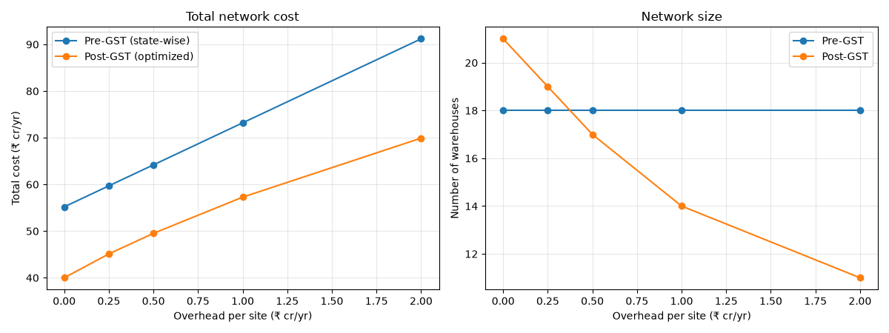
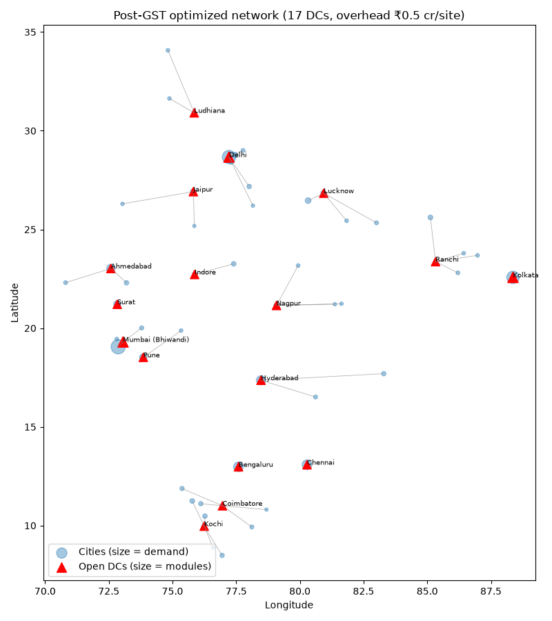
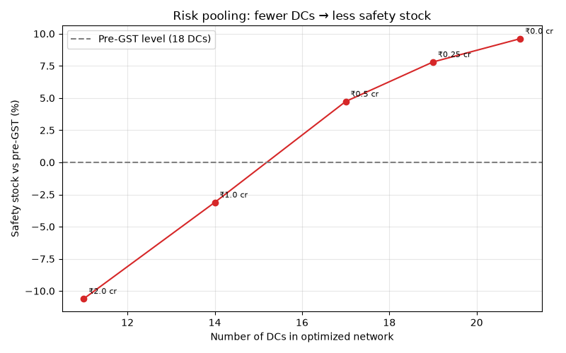
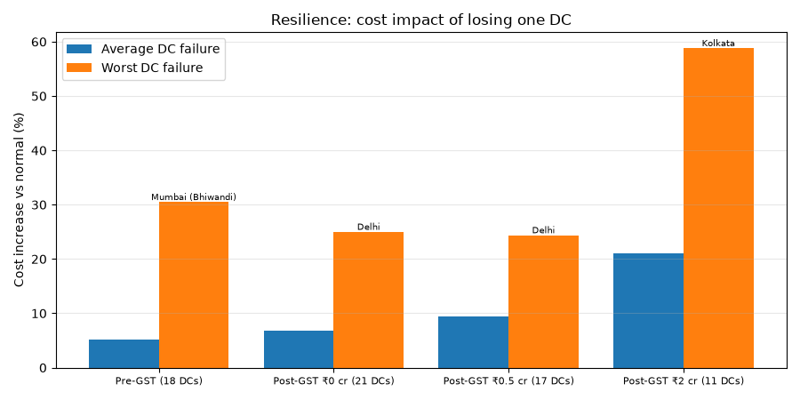

# 🚚 HubShift India: Post-GST Distribution Network Redesign

**Did GST make warehouse consolidation pay for an FMCG company, and what network should it run?**

A capacitated facility-location **MILP** (PuLP/CBC) that redesigns the distribution network of an edible-oil company at market-leader scale, serving India's **52 million-plus cities** from **27 candidate warehouse sites**. Every input is traced to a public source, and the one input that isn't (per-site overhead) is swept rather than assumed.

**▶ Live app:** *(add your Streamlit link here)*. Change overhead, freight rate, or knock out a DC and watch the network re-optimize.

---

## Key findings

| | Pre-GST (state-wise) | **Post-GST optimized** |
|---|---|---|
| Annual logistics cost | baseline | **22–28% lower** at every overhead level tested |
| State-border waste | ₹4.5 cr/yr (e.g. Ghaziabad served from Lucknow, 469 km vs 56 km from Delhi) | removed |
| One-warehouse-per-state waste | ₹10.1 cr/yr (e.g. Nagpur served from Bhiwandi, 742 km) | removed |
| Nagpur central hub | not used (Maharashtra's warehouse was in Bhiwandi) | **chosen in every scenario** |

**The trade-off triangle.** The best network depends on per-site overhead:

| Network | DCs | Cost vs pre-GST | Safety stock vs pre-GST | Worst single-DC failure |
|---|---|---|---|---|
| Spread out (₹0 overhead) | 21 | −27.5% | +9.6% | +25% |
| **Balanced (₹0.5 cr)** | **17** | **−22.9%** | **+4.7%** | **+24%** |
| Consolidated (₹2 cr) | 11 | −23.3% | −10.6% | **+59%** (Kolkata) |

> **Insight:** the savings from GST come mainly from **ignoring state borders and placing DCs where demand is**, not from consolidation. Consolidation only pays once per-site overhead is high, and it then pools inventory but makes the network fragile. This matches Knight Frank's 2018 observation that FMCG firms "would continue operating warehouses located close to consumption cluster."






---

## Data (all sourced, see `data/raw/`)

| Input | Value | Source |
|---|---|---|
| Demand points | 52 million-plus urban agglomerations, population | Census of India 2011 (final), Table A-04 |
| Demand per person | 19.7 kg/yr edible oil | NITI Aayog, *Pathways and Strategies for Accelerating Growth in Edible Oils* (2024) |
| Company size | 18.3% market share; ~22 mn t national consumption | ICICI Direct, Adani Wilmar IPO Review (Jan 2022) |
| Warehouse module | 20,000 sq ft (leader's avg depot: 1.7 mn sq ft / ~86 depots) | ICICI Direct (2022) |
| Throughput | 2.37 t/sq ft/yr (derived from the two rows above) | Derived |
| Rents | Median Grade A cluster rent, **199 cluster rows across 21 markets**, each checked against the report PDF | Knight Frank, *India Warehousing Market Report 2026* (2025 data) |
| Operating cost | 0.92 × rent (handling 24% vs warehousing 26% of logistics cost) | IIM figures via Knight Frank (2018) |
| Road distances | Real driving km, 27 × 52 | OSRM / OpenStreetMap (geocoded with Nominatim, state-checked) |
| Freight | ₹5/t-km base (32 ft, 16–18 t FTL) | TruckGuru market rates (Oct 2026); DPIIT ₹1.51/t-km as low bound |

**Flagged proxies:** Kerala, Andhra Pradesh, Jharkhand, Chhattisgarh and J&K have no Knight Frank rent table, so each borrows the nearest covered market's rent (marked `proxy` in `candidate_sites.csv`).

---

## Method

1. **`step1_data.py`**: loads raw CSVs, derives demand, rents and module cost; geocodes; fetches OSRM road distances.
2. **`step2_baseline.py`**: pre-GST network, with each city served by its own state's warehouse.
3. **`step3_milp.py`**: post-GST CFLP MILP. Binary site-open and city-assignment variables, integer 20,000 sq ft modules, single sourcing. Solved across per-site overhead of ₹0–2 cr.
4. **`step4_pooling.py`**: safety stock by the **square-root law**, Σ_DC √(Σ μᵢ²), relative to the baseline (z, CV and lead time cancel).
5. **`step5_resilience.py`**: N-1 stress test. Shut each DC, reroute its cities to the nearest open DC, measure the cost impact.
6. **`app.py`**: interactive Streamlit front end that solves the MILP live (~0.1 s).

---

## Limitations

- Census 2011 is the latest official census, so populations are dated (used as relative demand weights).
- Single product (edible oil), outbound DC→city freight only; inbound refinery→DC freight is not modelled.
- Per-site overhead has no public source, so it is swept (₹0–2 cr) instead of assumed.
- The safety-stock comparison assumes independent city demand with equal CV.
- The disruption test uses nearest-DC rerouting (a realistic emergency response, not a re-optimization).

---

## Run it

```bash
pip install -r requirements.txt
python src/step1_data.py        # needs internet (geocoding + OSRM), ~2 min first time
python src/step2_baseline.py
python src/step3_milp.py
python src/step4_pooling.py
python src/step5_resilience.py
streamlit run app.py
```

**Tech:** Python · pandas · PuLP (CBC) · Streamlit · Plotly · OSRM · OpenStreetMap

**Author:** Nalluri Sanjay, B.Tech (Hons.) Industrial & Systems Engineering, IIT Kharagpur · [LinkedIn](https://www.linkedin.com/in/sanjaynalluri2405/) · [GitHub](https://github.com/SanjayNalluri)
